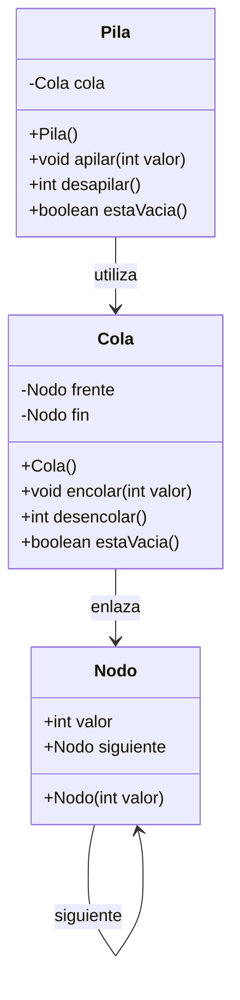
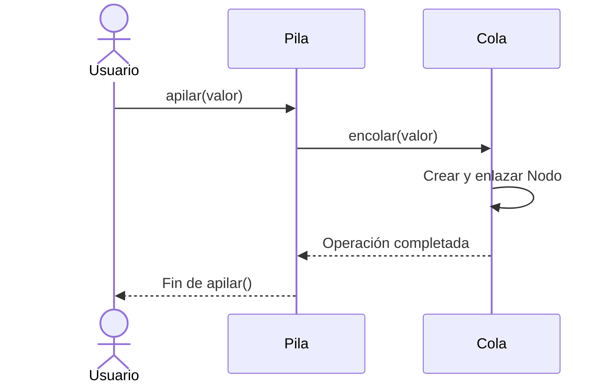
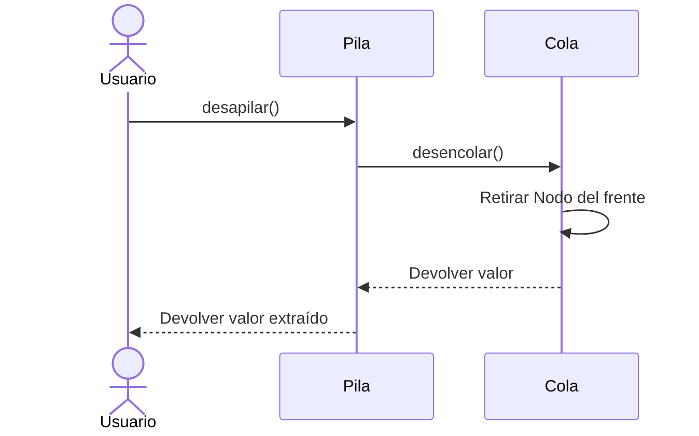

# Implementación de una Pila utilizando una Cola

**Autora:** Katerine Lisbeth Rafael Bourdierd  
**Asignatura:** Estructura de Datos y Algoritmos I  
**Proyecto:** Planteamiento del examen parcial

## 1. Mi planteamiento inicial

Mi propuesta inicial consiste en utilizar una instancia de `Cola` como atributo principal de la clase `Pila`.

La idea es reutilizar directamente los métodos que ya proporciona la cola:

- `encolar(int valor)`: para introducir un elemento en la estructura.
- `desencolar()`: para extraer un elemento de la estructura.
- `estaVacia()`: para comprobar si contiene elementos.

El planteamiento inicial de los métodos sería:

```java
public void apilar(int valor) {
    cola.encolar(valor);
}

public int desapilar() {
    return cola.desencolar();
}

public boolean estaVacia() {
    return cola.estaVacia();
}
```

## 3. UML de clases

El siguiente diagrama representa cómo planteo organizar las clases y sus relaciones.



## 4. Flujo de la operación apilar()

La operación comienza cuando el usuario proporciona un valor. La clase `Pila` recibe ese valor y utiliza el método `encolar()` de la cola para almacenarlo.



## 5. Flujo de la operación desapilar()

Cuando el usuario solicita extraer un elemento, la clase `Pila` llama al método `desencolar()` de la cola y devuelve el valor obtenido.



## 6. Conclusión

Mi planteamiento consiste en reutilizar la estructura `Cola` para construir una clase `Pila`, aprovechando los métodos `encolar()` y `desencolar()`.

La intención es mantener una implementación sencilla, reutilizar las clases proporcionadas y evitar crear estructuras adicionales.

Este documento recoge mi propuesta inicial y el flujo que tenía previsto para cada operación.

## 7. Diferencias entre mi respuesta del examen y el planteamiento desarrollado

Al comparar mi respuesta escrita en el examen con el planteamiento que desarrollo en este proyecto, considero que ambas propuestas mantienen la misma idea principal: utilizar una única instancia de `Cola` dentro de la clase `Pila` y aprovechar sus métodos para realizar las operaciones.

La diferencia está principalmente en cómo describo y organizo esas operaciones.

En mi hoja del examen planteé utilizar `encolar()` para introducir elementos y `desencolar()` para extraerlos. En este documento desarrollo esa misma idea mediante los métodos `apilar()` y `desapilar()`, mostrando cómo se relacionan con las operaciones de la cola.

Por tanto, mi planteamiento inicial no está alejado de la propuesta desarrollada, ya que parte de la misma estructura y de los mismos métodos. La diferencia está en el nivel de detalle y en la explicación del flujo de ejecución.

Reconozco que utilizar directamente `encolar()` y `desencolar()` no garantiza por sí solo el comportamiento LIFO de una pila, porque la cola trabaja con el criterio FIFO. Sin embargo, la base de mi propuesta sigue siendo la misma: reutilizar la cola como estructura interna, sin crear otra estructura de almacenamiento.