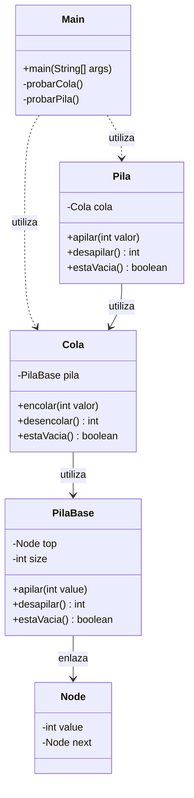
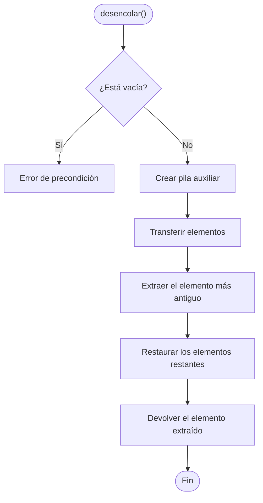
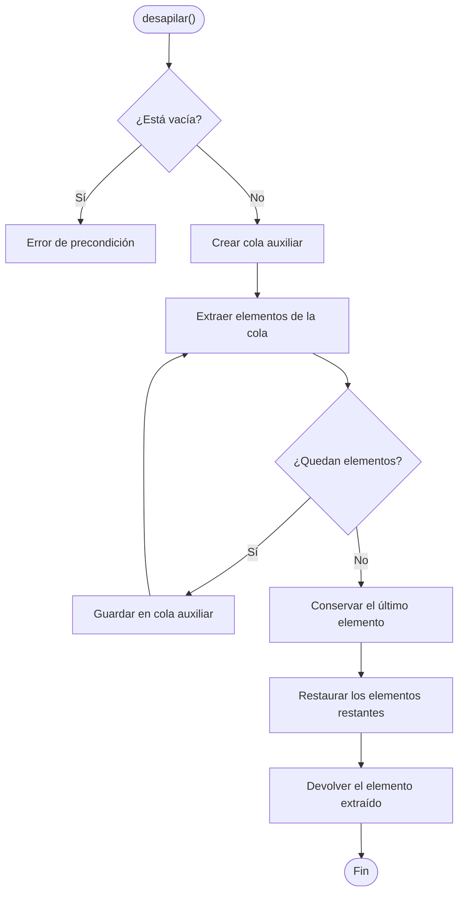

# 📚 Implementación de Pilas y Colas

Implementación de estructuras de datos utilizando otras estructuras, aplicando los principios **FIFO** y **LIFO**, nodos enlazados y estructuras auxiliares.

## 1. Objetivo

El proyecto consiste en implementar dos estructuras de datos:

- **Cola:** utiliza `PilaBase` para mantener el comportamiento FIFO.
- **Pila:** utiliza `Cola` para mantener el comportamiento LIFO.

Además, se implementa `PilaBase` mediante nodos enlazados.

## 2. Clases del proyecto

| Clase | Responsabilidad |
|---|---|
| `Main` | Ejecutar y mostrar las pruebas. |
| `Cola` | Implementar una cola utilizando una pila. |
| `Pila` | Implementar una pila utilizando una cola. |
| `PilaBase` | Implementar una pila mediante nodos enlazados. |
| `Node` | Almacenar valores y referencias al siguiente nodo. |

## 3. Diagrama general de clases

## 4. Funcionamiento de las estructuras

### Cola utilizando una pila

La cola aplica el principio **FIFO (First In, First Out)**: el primer elemento en entrar es el primero en salir.

Para desencolar, se crea una pila auxiliar temporal, se transfieren los elementos, se extrae el más antiguo y se restauran los elementos restantes.

### Pila utilizando una cola

La pila aplica el principio **LIFO (Last In, First Out)**: el último elemento en entrar es el primero en salir.

Para desapilar, se crea una cola auxiliar temporal, se transfieren todos los elementos excepto el último, se conserva ese último como resultado y se restauran los demás.

