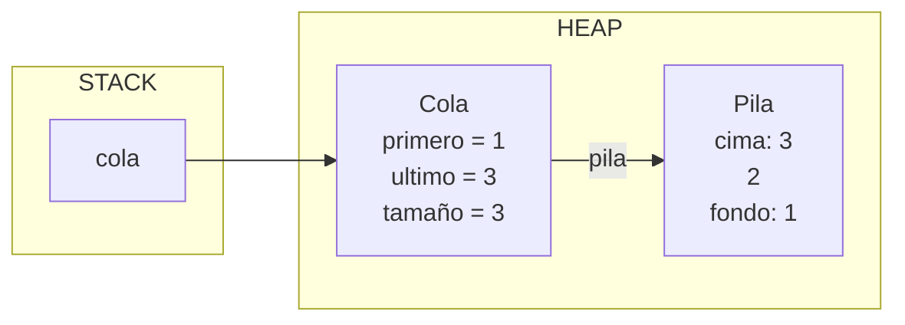
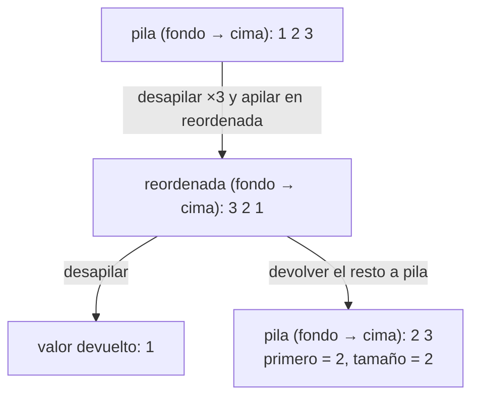
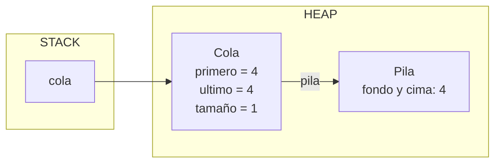

# Registro de desviaciones – Cola con Pila

Comparación entre el diseño congelado (Parte 1) y el código entregado (`Cola.java`).

La estrategia del diseño es viable y se implementa tal cual. Como no tengo copia de los diagramas entregados en el punto 3, se declara una enmienda por si contradicen esa estrategia.

## Enmienda – 10/11/2026: diagramas del punto 3 con comportamiento de pila

**Aviso.** No conservo copia de el diagrama en hoja entregada, y conservo dos versiones de ellos:

- **Caso 1 = Diagrama construido con funcionamiento de cola:** se desencola el 1 y al final queda el 4. Es coherente con la estrategia (comportamiento de cola). Si la hoja entregada es así, en este punto **no hay desviación**.
- **Caso 2 = Diagrama construido erroneamente con funcionamiento de pila:** cada `desencolar()` saca el **último** dato encolado. Si la hoja entregada es así, se aplica esta enmienda.

**Qué falla (si aplica).** 

| Operación (diagrama recordado) | Desencola | primero | ultimo | tamaño |
|---|---|---|---|---|
| encolar(1) | — | 1 | 1 | 1 |
| encolar(2) | — | 1 | 2 | 2 |
| encolar(3) | — | 1 | 3 | 3 |
| desencolar() | **3** | 1 | 2 | 2 |
| encolar(4) | — | 1 | 4 | 3 |
| desencolar() | **4** | 1 | 2 | 2 |
| desencolar() | **2** | 1 | 1 | 1 |

Ese orden de salida (3, 4, 2) es el de una **pila (LIFO)**, no el de una cola (FIFO). Además, contradice la estrategia del propio diseño (punto 1):

- La estrategia dice "el último en pila, primero en cola".
- Según la estrategia, `desencolar` desapila n veces y devuelve el último dato desapilado. Ese dato es el que está al fondo de la pila, es decir, el **primero** que se encoló.

**Cómo se comprobó.** Se aplicó la estrategia del punto 1 a la secuencia del examen y se ejecutó `ColaPrueba.java`. Los `desencolar()` devuelven **1, 2, 3**, no 3, 4, 2 como en los diagramas recordados.

**Qué cambia.**

- El código sigue la estrategia del punto 1 y el contrato de `Cola` (FIFO).
- Las pruebas verifican 1, 2 y 3.
- La traza correcta, que es la que sigue el código, es esta:

| Operación | Pila (fondo → cima) | Desencola | primero | ultimo | tamaño |
|---|---|---|---|---|---|
| encolar(1) | 1 | — | 1 | 1 | 1 |
| encolar(2) | 1 2 | — | 1 | 2 | 2 |
| encolar(3) | 1 2 3 | — | 1 | 3 | 3 |
| desencolar() | 2 3 | **1** | 2 | 3 | 2 |
| encolar(4) | 2 3 4 | — | 2 | 4 | 3 |
| desencolar() | 3 4 | **2** | 3 | 4 | 2 |
| desencolar() | 4 | **3** | 4 | 4 | 1 |

Al desencolar cambia `primero`, no `ultimo`: en una cola los datos salen por el frente y entran por el final.

**Nota sobre el dibujo.** Los diagramas dibujaban los `int` como cajas enlazadas y hablaban de que `primero` y `ultimo` eran "referencias" a esos datos. `int` es un tipo primitivo: no hay un objeto ni una referencia por cada dato, y no se permiten nodos. El estado real es un objeto `Cola` que referencia un objeto `Pila` y guarda tres valores `int` (`primero`, `ultimo` y `tamaño`), que son copias de los valores.

## Diagramas de memoria del código entregado

**Tras `encolar(1)`, `encolar(2)` y `encolar(3)`:**

**Qué hace `desencolar()` por dentro** (`reordenada` es una variable local del método y desaparece al terminar):

**Al final de la secuencia** (salieron 1, 2 y 3):

## Lo que se mantiene igual que en el diseño

- **Representación:** la cola usa una `Pila` como atributo. `encolar` llama a `pila.apilar(valor)`.
- **Atributos:** `primero`, `ultimo` y `tamaño`, como en el diagrama. `tamaño` se incrementa al encolar.
- **Desencolar:** se desapila n veces (n = `tamaño`) sobre una pila nueva ("referencia nueva"), que deja los datos reordenados. El último desapilado queda primero en la cola. Los datos que no se querían desencolar vuelven a la pila original.
- **`estaVacia()`:** funciona igual que en la `Pila`, porque delega en `pila.estaVacia()`.
- **Precondición:** `desencolar` exige `!estaVacia()` y la expresa con `assert`.

## Desviaciones

| # | Diseño congelado | Código entregado | Justificación |
|---|---|---|---|
| 1 | Meter un dato extra para que la pila y la cola no queden vacías mientras se ejecuta `desencolar`. | No se usa dato extra. | Fue un malentendido del enunciado: la precondición `!estaVacia()` solo se exige al **llamar** a `desencolar`, no durante su ejecución. El bucle lo controla `tamaño`, así que nunca se desapila una pila vacía. Además, un dato extra de tipo `int` sería indistinguible de un valor real del cliente. |
| 2 | Los datos que no se desencolan "vuelven a ser encolados". | Vuelven con `pila.apilar(...)`, no llamando a `encolar(...)`. | Llamar a `encolar` incrementaría `tamaño` y cambiaría `ultimo` en mitad de la operación. Apilar directamente devuelve los datos sin alterar los atributos. |
| 3 | Solo se describe `tamaño++` al encolar. | `desencolar` hace `tamaño--`. | Es necesario para mantener el invariante "tamaño = número de elementos de la pila". |
| 4 | `primero` no cambia en ningún diagrama. | `desencolar` actualiza `primero` al siguiente dato. | Consecuencia de la enmienda: en una cola, al sacar el frente, el siguiente pasa a ser el primero. |
| 5 | Nota sobre una "clase de recubrimiento" con un método para obtener el valor desapilado. | No se implementa. | `Pila` no se puede modificar, y `desapilar()` ya devuelve el valor. |

## Pruebas

`ColaPrueba.java` reproduce la secuencia `encolar(1)`, `encolar(2)`, `encolar(3)`, `desencolar()`, `encolar(4)`, `desencolar()`, `desencolar()` y verifica con `assert` que los `desencolar()` devuelven **1, 2 y 3**. También comprueba que al final queda el 4. La última prueba (`probarPrecondicionColaVacia`) desencola una cola vacía a propósito: el programa termina con `AssertionError`, lo que demuestra la precondición. Se ejecuta con `java -ea ColaPrueba`.
